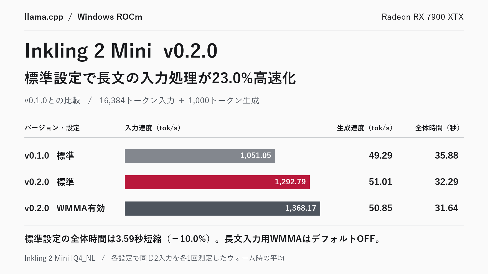
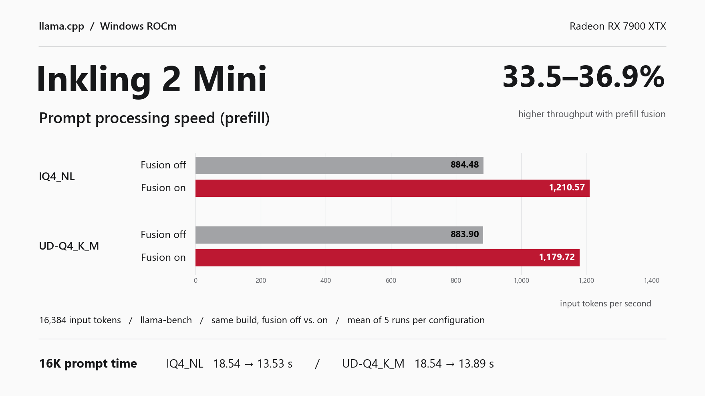
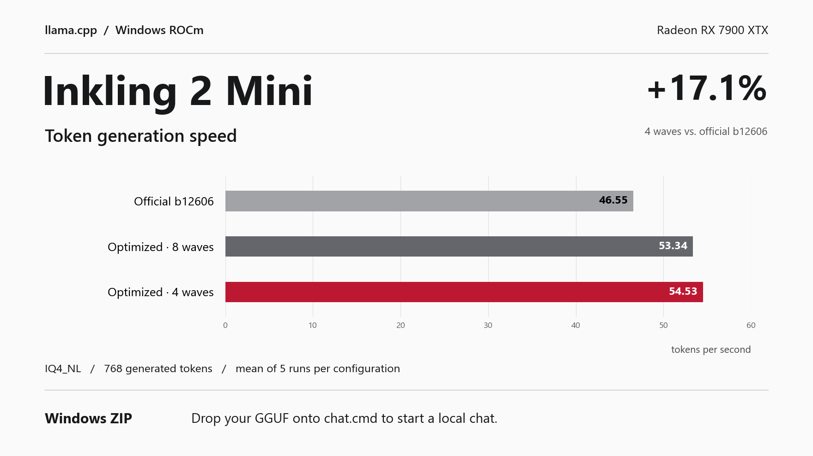

# Windows ROCmで使う Inkling 2 Mini

[English](README.md) · [日本語](README.ja.md) · [简体中文](README.zh-Hans.md) · [繁體中文](README.zh-Hant.md)

**[v0.2.0](https://github.com/kanten2/llama.cpp-inkling-rdna3/releases/tag/v0.2.0)** · Windows x64・Radeon RX 7900 XTX向け。長文入力用のWMMA Attentionを同梱し、初期設定はOFFです。



IQ4_NLで16,384トークンを入力し、1,000トークンを生成しました。全設定で同じ2入力を各1回測定したウォーム時の平均です。

| 設定 | 入力 (tok/s) | 生成 (tok/s) | リクエスト全体 (秒) |
|---|---:|---:|---:|
| v0.1.0 | 1,051.05 | 49.29 | 35.88 |
| v0.2.0 (標準) | 1,292.79 | 51.01 | 32.29 |
| v0.2.0 (WMMA) | 1,368.17 | 50.85 | 31.64 |

前版比で標準設定の入力速度は23.0%、生成速度は3.5%向上し、全体時間は10.0%短縮しました。標準設定では2入力とも前版と生成トークンが全件一致しました。WMMAでは生成内容が変わることがあります。別の日本語長文読解テストは両設定とも72/88問正解でした。 [16K benchmark](https://github.com/kanten2/llama.cpp-inkling-rdna3/blob/v0.2.0/benchmarks/inkling-rocm/v0.2.0/speed.json) · [88 QA](https://github.com/kanten2/llama.cpp-inkling-rdna3/blob/v0.2.0/benchmarks/inkling-rocm/v0.2.0/reading.json)

WMMAを有効にするには、ZIPを展開したフォルダーでPowerShellを開き、次を実行します。新しいPowerShellでは標準設定で起動します。

```powershell
$env:INKLING_ATTN_DIRECT = '1'
$env:INKLING_ATTN_WMMA = '1'
.\chat.cmd "C:\models\Inkling-2-Mini-IQ4_NL.gguf"
```


## 最適化の内容

入力を読み込むプリフィルでは、注意機構が必要とするメモリ配置に位置補正値を直接書き込み、中間コピーを省きます。回答を1トークンずつ生成するデコードでは、クリップや畳み込みなどのGPU処理をまとめ、複数の層で使う中間結果を再利用します。IQ4_NLでは、エキスパートのgate/up射影に4ウェーブのGPUカーネルも使用します。[最適化の詳細](benchmarks/inkling-rocm/README.md)

## 実測結果

### 入力の読み込み（プリフィル）

各GGUFで同一ビルドの高速化をオン・オフにして各5回測定しました。入力処理速度は16,384トークンで **IQ4_NLが36.9%、UD-Q4_K_Mが33.5%向上**し、4,096トークンではそれぞれ11.6%、10.7%向上しました。[生データ・正答検証・再現手順](benchmarks/inkling-rocm/prefill/README.md)



### 回答の生成（デコード）

以下はIQ4_NLを使い、HIP Graphsを有効にして各5回測った平均（tok/s）です。pp512はプリフィル高速化を追加する前の測定値です。



| 測定項目 | 公式b12606 | 最適化・8ウェーブ | 最適化・4ウェーブ |
|---|---:|---:|---:|
| 512トークンの入力処理（pp512） | 1,557.49 | 1,557.21 | 1,556.51 |
| 128トークンの生成（tg128） | 46.00 | 52.94 | 54.16 |
| 768トークンの生成（tg768） | 46.55 | 53.34 | **54.53** |

両モードとも日本語25問に全問正答しました。25問の完答時間は8ウェーブで430.55秒、4ウェーブで365.76秒でした。4ウェーブでは生成トークン数も13.3%少なく、完答時間に影響しています。[ベンチマークの条件・標準偏差](benchmarks/inkling-rocm/llama-bench-b12606/README.md) · [問題・回答・採点方法](benchmarks/inkling-rocm/quality/README.md)

Unsloth Mainline_Support UD-Q4_K_Mのtg768は、ループ層のスケール修正（#32704）のみの48.63 tok/sから、最適化後は56.67 tok/sになりました（+16.54%）。このGGUFではgate/up重みの形式が異なり、IQ4_NL専用の4ウェーブカーネルの起動回数は0でした。比較した3構成はいずれも5問に全問正答しました。[UD-Q4_K_Mの測定と起動ログ](benchmarks/inkling-rocm/ud-q4km-pr32704/README.md)

## Windows ZIPの使い方

1. [正式版 v0.2.0](https://github.com/kanten2/llama.cpp-inkling-rdna3/releases/tag/v0.2.0) から `inkling-rdna3-windows-gfx1100.zip` をダウンロードし、「すべて展開」を選びます。公開ページにZIPのSHA-256もあります。ROCmランタイムは同梱されています。対応するAMDドライバーと [Visual C++ x64ランタイム](https://aka.ms/vs/17/release/vc_redist.x64.exe) が必要です。
2. [IQ4_NL](https://huggingface.co/ggml-org/Inkling-2-Mini-GGUF) または [Unsloth Mainline_Support UD-Q4_K_M](https://huggingface.co/unsloth/Inkling-2-Mini-GGUF/tree/main/Mainline_Support) のGGUFを別途用意します。Unsloth版は拡張子を `.gguf_file` から `.gguf` に変更します。
3. GGUFを **chat.cmd** にドラッグすると、ブラウザーにコンテキスト4,096トークンのローカルチャットが開きます。利用中はコンソールを開いたままにします。
4. 測速時はチャットのコンソールで **Ctrl+C** を押して停止し、同じGGUFを **bench.cmd** にドラッグします。GPU名と、ウォームアップ後に768トークンを生成した速度が表示されます。

## 本家llama.cppの資料

このフォークのベースはllama.cpp b12606です。本家のツール・開発手順、貢献案内、依存ライブラリの情報は以下から参照できます。[本家の文書一覧](https://github.com/ggml-org/llama.cpp/blob/b12606/README.md#documentation) · [本家への貢献](https://github.com/ggml-org/llama.cpp/blob/b12606/CONTRIBUTING.md) · [謝辞](https://github.com/ggml-org/llama.cpp/blob/b12606/README.md#acknowledgements) · [ライセンス](LICENSE)
