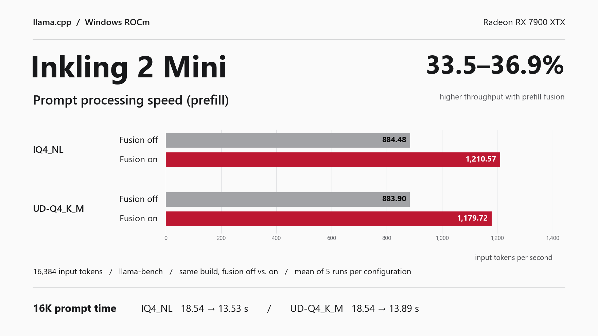
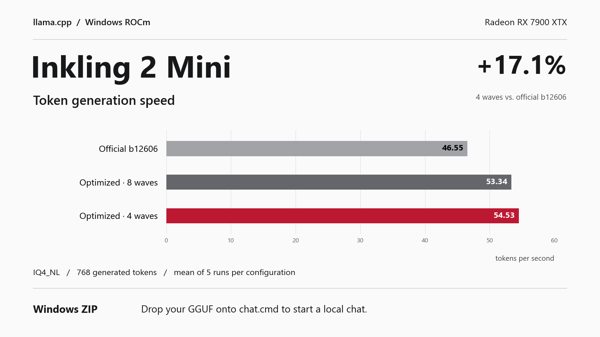

# Inkling 2 Mini on Windows ROCm

[English](README.md) · [日本語](README.ja.md) · [简体中文](README.zh-Hans.md) · [繁體中文](README.zh-Hant.md)

**[v0.2.0](https://github.com/kanten2/llama.cpp-inkling-rdna3/releases/tag/v0.2.0)** · Windows x64 · Radeon RX 7900 XTX. Long-prompt WMMA Attention is included and defaults to off.

IQ4_NL, 16,384 input tokens and 1,000 generated tokens. Each configuration ran the same two prompts once each. Values are means of warm requests.

| Mode | Prefill (tok/s) | Decode (tok/s) | Request (s) |
|---|---:|---:|---:|
| v0.1.0 | 1,051.05 | 49.29 | 35.88 |
| v0.2.0 (Default) | 1,292.79 | 51.01 | 32.29 |
| v0.2.0 (WMMA) | 1,368.17 | 50.85 | 31.64 |

Default throughput improved 23.0% for prefill and 3.5% for decode. Request time fell 10.0%. Both default continuations matched v0.1.0 token for token. With WMMA, greedy answers can change. Both modes scored 72/88 on a separate Japanese reading test. [16K benchmark](https://github.com/kanten2/llama.cpp-inkling-rdna3/blob/v0.2.0/benchmarks/inkling-rocm/v0.2.0/speed.json) · [88 QA](https://github.com/kanten2/llama.cpp-inkling-rdna3/blob/v0.2.0/benchmarks/inkling-rocm/v0.2.0/reading.json)

To enable WMMA, run these commands in PowerShell from the extracted ZIP folder. A fresh shell uses the defaults.

```powershell
$env:INKLING_ATTN_DIRECT = '1'
$env:INKLING_ATTN_WMMA = '1'
.\chat.cmd "C:\models\Inkling-2-Mini-IQ4_NL.gguf"
```


ZIP and source build guides · [English](packaging/inkling-windows/README.md) · [日本語](packaging/inkling-windows/README.ja.md) · [简体中文](packaging/inkling-windows/README.zh-Hans.md) · [繁體中文](packaging/inkling-windows/README.zh-Hant.md)

## What the fork optimizes

During prefill, the GPU reads the prompt before generating its answer. This fork copies Inkling's relative-position bias values directly into the layout needed for attention, saving an intermediate copy. During generation, it combines GPU operations for row clipping and convolution and reuses results shared by multiple layers. For IQ4_NL, the ZIP also enables a four-wave GPU kernel for the routed experts' gate and up projections. [Optimization and profiling notes](benchmarks/inkling-rocm/README.md)

## Measured results

### Prompt processing (prefill)

The chart compares fusion off and on within the same build for each GGUF. Input throughput increased **36.9% for IQ4_NL** and **33.5% for UD-Q4_K_M** at 16,384 tokens. At 4,096 tokens the gains were 11.6% and 10.7%, respectively. [Raw timings, answer checks and reproduction steps](benchmarks/inkling-rocm/prefill/README.md)



### Token generation (decode)

The earlier IQ4_NL decode benchmark compares the official b12606 distribution with the fork's eight- and four-wave modes. Values below are five-run means in tokens/s, with HIP Graphs enabled. The pp512 row was measured before the prefill change.



| Workload | Official b12606 | Optimized, 8 waves | Optimized, 4 waves |
|---|---:|---:|---:|
| Process a 512-token prompt (pp512) | 1,557.49 | 1,557.21 | 1,556.51 |
| Generate 128 tokens (tg128) | 46.00 | 52.94 | 54.16 |
| Generate 768 tokens (tg768) | 46.55 | 53.34 | **54.53** |

[Benchmark commands, raw JSON and standard deviations](benchmarks/inkling-rocm/llama-bench-b12606/README.md)

**Answer checks.** Both optimized modes answered **25/25** Japanese questions correctly. Each question ran once per mode. Completing all 25 answers took 430.55 s with eight waves and 365.76 s with four. The four-wave run generated 13.3% fewer tokens, which also contributed to the shorter time. [Questions, recorded answers and grading instructions](benchmarks/inkling-rocm/quality/README.md)

**Unsloth Mainline_Support UD-Q4_K_M.** On the same GPU, tg768 rose from **48.63 to 56.67 tokens/s (+16.54%)** with the default optimizations. All three builds in this comparison included the upstream looped expert-scale fix (#32704) and scored 5/5 on the answer checks. This GGUF uses a different weight format for the gate and up projections. Logs showed zero four-wave kernel activations in the five runs with the option enabled. [UD-Q4_K_M benchmark, kernel logs and reproduction steps](benchmarks/inkling-rocm/ud-q4km-pr32704/README.md)

## Use the Windows ZIP

You need Windows x64, a Radeon RX 7900 XTX with a compatible AMD driver, and the Visual C++ x64 runtime. The ZIP includes the ROCm runtime. [Microsoft Visual C++ x64 runtime](https://aka.ms/vs/17/release/vc_redist.x64.exe)

1. Download `inkling-rdna3-windows-gfx1100.zip` and choose **Extract All** in Explorer. The release also includes the ZIP's SHA-256 checksum. [Download v0.2.0 for Windows](https://github.com/kanten2/llama.cpp-inkling-rdna3/releases/tag/v0.2.0)
2. Download a compatible Inkling 2 Mini text model separately. For the Unsloth version, choose the file in `Mainline_Support` and rename its extension from `.gguf_file` to `.gguf`. [IQ4_NL model](https://huggingface.co/ggml-org/Inkling-2-Mini-GGUF) · [Unsloth UD-Q4_K_M model](https://huggingface.co/unsloth/Inkling-2-Mini-GGUF/tree/main/Mainline_Support)
3. Drag the GGUF onto **`chat.cmd`**. Once the model loads, your default browser opens a local text chat with a 4,096-token context. Keep the console open while chatting.
4. To check speed, press **Ctrl+C in the chat console** to stop the server, then drag the same GGUF onto **`bench.cmd`**. It prints the GPU name and the speed of one timed 768-token generation after warm-up.

Both launchers use your Windows display language. The four guides above cover language selection and building the ZIP from source.

## About the upstream llama.cpp project

This fork is based on ggml-org's **llama.cpp b12606**. The following resources belong to the original project.

- **Tools and development.** The upstream documentation covers the CLI, server, Docker, Android, multi-GPU setups and other platforms. [Upstream documentation index](https://github.com/ggml-org/llama.cpp/blob/b12606/README.md#documentation)
- **Contributing to ggml-org/llama.cpp.** The original maintainers explain how they review pull requests and grant roles in their repository. [Upstream contributing guide](https://github.com/ggml-org/llama.cpp/blob/b12606/CONTRIBUTING.md)
- **Acknowledgements and licenses.** The original project credits the libraries used by llama.cpp. The Windows ZIP includes third-party notices in its `licenses/` folder. [Upstream acknowledgements](https://github.com/ggml-org/llama.cpp/blob/b12606/README.md#acknowledgements) · [llama.cpp license](LICENSE)
