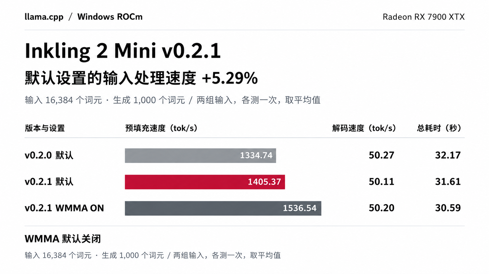
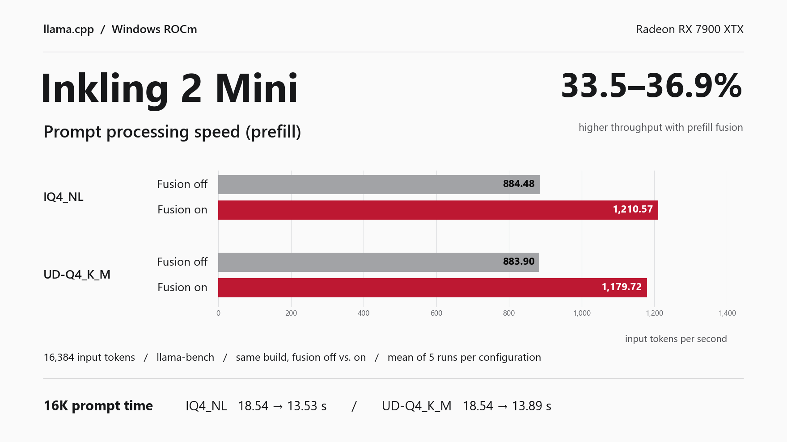
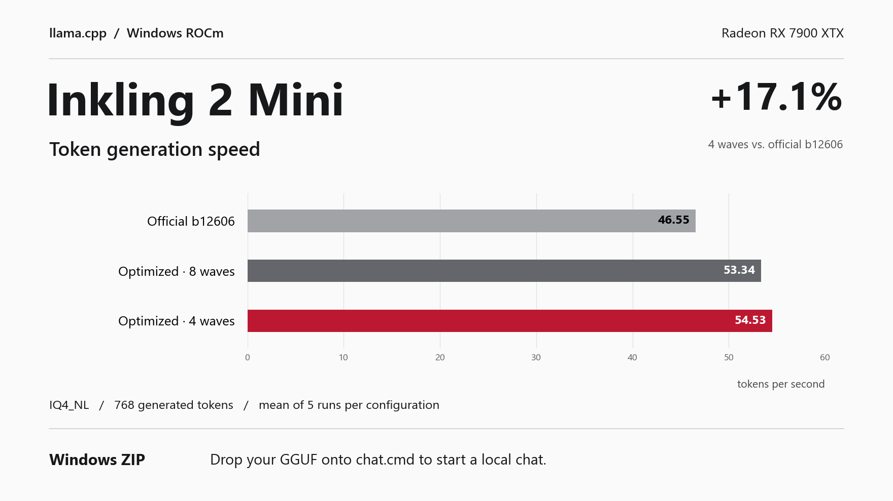

# 在 Windows ROCm 上运行 Inkling 2 Mini

[English](README.md) · [日本語](README.ja.md) · [简体中文](README.zh-Hans.md) · [繁體中文](README.zh-Hant.md)

**[v0.2.1](https://github.com/kanten2/llama.cpp-inkling-rdna3/releases/tag/v0.2.1)** · 适用于 Windows x64 和 Radeon RX 7900 XTX。长文本输入的 WMMA Attention 默认关闭。



IQ4_NL，输入 16,384 个 token，生成 1,000 个 token。每个配置均在预热后对相同的两个输入各测一次，表中为平均值。

| 配置 | 输入 (tok/s) | 生成 (tok/s) | 请求耗时 (秒) |
|---|---:|---:|---:|
| v0.2.0 | 1,334.74 | 50.27 | 32.17 |
| v0.2.1 (默认) | 1,405.37 | 50.11 | 31.61 |
| v0.2.1 (WMMA) | 1,536.54 | 50.20 | 30.59 |

在 RX 7900 XTX 和 Windows ROCm 上，默认关闭 WMMA 时，16K 输入处理速度比 v0.2.0 **提高 5.29%**，平均请求耗时**缩短 1.76%**。两个测试输入各生成 1,000 个词元，在默认设置下均与 v0.2.0 完全一致。启用 WMMA 后，贪心解码的输出可能改变。 [16K benchmark](https://github.com/kanten2/llama.cpp-inkling-rdna3/blob/v0.2.1/benchmarks/inkling-rocm/v0.2.1/speed.json)

在解压目录打开 PowerShell，执行以下命令启用 WMMA。新开的 PowerShell 使用默认设置。

```powershell
$env:INKLING_ATTN_DIRECT = '1'
$env:INKLING_ATTN_WMMA = '1'
.\chat.cmd "C:\models\Inkling-2-Mini-IQ4_NL.gguf"
```


## 优化内容

预填充阶段直接按注意力计算所需的内存布局写入相对位置偏置，省去一次中间复制。逐个生成 token 时，程序合并裁剪和卷积等 GPU 操作，并复用多层共用的中间结果。IQ4_NL 的专家 gate/up 投影还会使用四 wave 的 GPU 内核。[优化说明](benchmarks/inkling-rocm/README.md)

## 实测结果

### 提示词处理（预填充）

对每种 GGUF，在同一构建版本中分别开启和关闭预填充融合，每种配置测量五次。输入为 16,384 个 token 时，**IQ4_NL 吞吐量提高 36.9%，UD-Q4_K_M 提高 33.5%**。输入为 4,096 个 token 时，分别提高 11.6% 和 10.7%。[原始数据、答案核验与复现步骤](benchmarks/inkling-rocm/prefill/README.md)



### 回答生成（解码）

下表为 IQ4_NL 开启 HIP Graphs 后五次测量的平均值，单位为 tok/s。pp512 的数据采集于加入预填充优化之前。



| 测试项 | 官方 b12606 | 优化版（8 waves） | 优化版（4 waves） |
|---|---:|---:|---:|
| 处理 512 token (pp512) | 1,557.49 | 1,557.21 | 1,556.51 |
| 生成 128 token (tg128) | 46.00 | 52.94 | 54.16 |
| 生成 768 token (tg768) | 46.55 | 53.34 | **54.53** |

两种模式均答对全部 25 道日语题。八 wave 模式总耗时 430.55 秒，四 wave 模式总耗时 365.76 秒。四 wave 模式生成的 token 减少了 13.3%，这也缩短了完成时间。[测试条件与标准差](benchmarks/inkling-rocm/llama-bench-b12606/README.md) · [题目、回答与评分方法](benchmarks/inkling-rocm/quality/README.md)

对于 Unsloth Mainline_Support UD-Q4_K_M，tg768 从仅修复循环层缩放（#32704）时的 48.63 tok/s 提高到优化后的 56.67 tok/s（+16.54%）。这款 GGUF 的 gate/up 权重格式不同，日志中 IQ4_NL 专用的四 wave 内核调用次数为零。三种配置均答对全部五道题。[UD-Q4_K_M 测试与运行日志](benchmarks/inkling-rocm/ud-q4km-pr32704/README.md)

## 使用 Windows ZIP

1. 从 [v0.2.1 正式版页面](https://github.com/kanten2/llama.cpp-inkling-rdna3/releases/tag/v0.2.1) 下载 `inkling-rdna3-windows-gfx1100.zip`，在资源管理器中选择“全部解压缩”。发布页面提供 ZIP 的 SHA-256 校验值。压缩包已包含 ROCm 运行时，系统需要兼容的 AMD 驱动和 [Visual C++ x64 运行时](https://aka.ms/vs/17/release/vc_redist.x64.exe)。
2. 另行下载 [IQ4_NL](https://huggingface.co/ggml-org/Inkling-2-Mini-GGUF) 或 [Unsloth Mainline_Support UD-Q4_K_M](https://huggingface.co/unsloth/Inkling-2-Mini-GGUF/tree/main/Mainline_Support) 的 GGUF。使用 Unsloth 版时，将扩展名从 `.gguf_file` 改为 `.gguf`。
3. 将 GGUF 拖到 **chat.cmd**，浏览器会打开上下文长度为 4,096 个 token 的本地文本聊天界面。聊天期间保持控制台开启。
4. 测速前在聊天控制台按 **Ctrl+C** 停止服务，再将同一 GGUF 拖到 **bench.cmd**。屏幕会显示显卡名称和预热后生成 768 个 token 的速度。

## 上游 llama.cpp 文档

本分支基于 llama.cpp b12606。上游项目提供工具文档、贡献指南和第三方库说明。[上游文档](https://github.com/ggml-org/llama.cpp/blob/b12606/README.md#documentation) · [贡献指南](https://github.com/ggml-org/llama.cpp/blob/b12606/CONTRIBUTING.md) · [致谢](https://github.com/ggml-org/llama.cpp/blob/b12606/README.md#acknowledgements) · [许可证](LICENSE)
