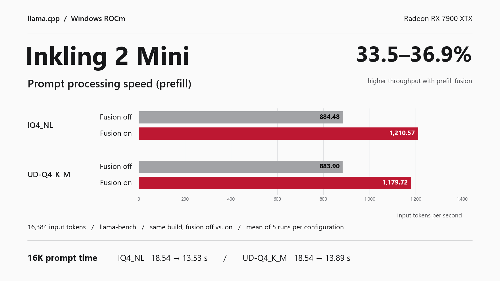
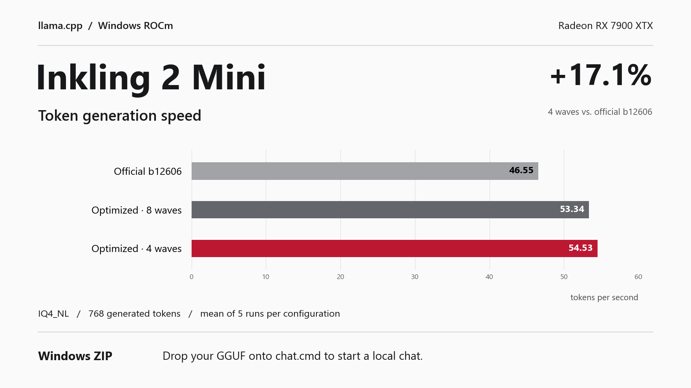

# 在 Windows ROCm 上執行 Inkling 2 Mini

[English](README.md) · [日本語](README.ja.md) · [简体中文](README.zh-Hans.md) · [繁體中文](README.zh-Hant.md)

**[v0.2.0](https://github.com/kanten2/llama.cpp-inkling-rdna3/releases/tag/v0.2.0)** · 適用於 Windows x64 和 Radeon RX 7900 XTX。長文輸入的 WMMA Attention 預設關閉。

IQ4_NL，輸入 16,384 個 token，生成 1,000 個 token。每個設定均在暖機後對相同的兩個輸入各測一次，表中為平均值。

| 設定 | 輸入 (tok/s) | 生成 (tok/s) | 請求耗時 (秒) |
|---|---:|---:|---:|
| v0.1.0 | 1,051.05 | 49.29 | 35.88 |
| v0.2.0 (預設) | 1,292.79 | 51.01 | 32.29 |
| v0.2.0 (WMMA) | 1,368.17 | 50.85 | 31.64 |

預設配置的輸入速度提高 23.0%，生成速度提高 3.5%，請求耗時縮短 10.0%。兩個輸入的生成 token 均與前版完全一致。啟用 WMMA 後回答可能改變。日文閱讀測試中兩種設定均答對 72/88 題。 [16K benchmark](https://github.com/kanten2/llama.cpp-inkling-rdna3/blob/v0.2.0/benchmarks/inkling-rocm/v0.2.0/speed.json) · [88 QA](https://github.com/kanten2/llama.cpp-inkling-rdna3/blob/v0.2.0/benchmarks/inkling-rocm/v0.2.0/reading.json)

在解壓縮目錄開啟 PowerShell，執行以下命令啟用 WMMA。新開的 PowerShell 使用預設設定。

```powershell
$env:INKLING_ATTN_DIRECT = '1'
$env:INKLING_ATTN_WMMA = '1'
.\chat.cmd "C:\models\Inkling-2-Mini-IQ4_NL.gguf"
```


## 最佳化內容

預填充階段會依照注意力運算所需的記憶體排列方式，直接寫入相對位置偏差值，省去一次中間複製。逐一生成 token 時，程式會合併裁切與卷積等 GPU 運算，並重複使用多層共用的中間結果。IQ4_NL 的專家 gate/up 投影還會使用四個 wave 的 GPU 核心函式。[最佳化說明](benchmarks/inkling-rocm/README.md)

## 實測結果

### 提示詞處理（預填充）

針對每種 GGUF，在同一建置版本中分別開啟與關閉預填充融合，每種設定量測五次。輸入為 16,384 個 token 時，**IQ4_NL 吞吐量提升 36.9%，UD-Q4_K_M 提升 33.5%**。輸入為 4,096 個 token 時，分別提升 11.6% 與 10.7%。[原始數據、答案驗證與重現步驟](benchmarks/inkling-rocm/prefill/README.md)



### 回答生成（解碼）

下表為 IQ4_NL 啟用 HIP Graphs 後五次量測的平均值，單位為 tok/s。pp512 的數據取自加入預填充最佳化之前。



| 測試項目 | 官方 b12606 | 最佳化版（8 waves） | 最佳化版（4 waves） |
|---|---:|---:|---:|
| 處理 512 token (pp512) | 1,557.49 | 1,557.21 | 1,556.51 |
| 生成 128 token (tg128) | 46.00 | 52.94 | 54.16 |
| 生成 768 token (tg768) | 46.55 | 53.34 | **54.53** |

兩種模式均答對全部 25 道日文題。八個 wave 的模式共耗時 430.55 秒，四個 wave 的模式共耗時 365.76 秒。後者生成的 token 減少 13.3%，也縮短了作答時間。[測試條件與標準差](benchmarks/inkling-rocm/llama-bench-b12606/README.md) · [題目、回答與評分方式](benchmarks/inkling-rocm/quality/README.md)

使用 Unsloth Mainline_Support UD-Q4_K_M 時，tg768 從僅修正循環層縮放（#32704）的 48.63 tok/s 提升至最佳化後的 56.67 tok/s（+16.54%）。這款 GGUF 的 gate/up 權重格式不同，紀錄顯示 IQ4_NL 專用的四 wave 核心函式啟動次數為零。三種設定均答對全部五道題。[UD-Q4_K_M 測試與執行紀錄](benchmarks/inkling-rocm/ud-q4km-pr32704/README.md)

## 使用 Windows ZIP

1. 從 [v0.2.0 正式版頁面](https://github.com/kanten2/llama.cpp-inkling-rdna3/releases/tag/v0.2.0) 下載 `inkling-rdna3-windows-gfx1100.zip`，在檔案總管選取「全部解壓縮」。發行頁面提供 ZIP 的 SHA-256 校驗值。壓縮檔已包含 ROCm 執行階段，系統需要相容的 AMD 驅動程式與 [Visual C++ x64 執行階段](https://aka.ms/vs/17/release/vc_redist.x64.exe)。
2. 另行下載 [IQ4_NL](https://huggingface.co/ggml-org/Inkling-2-Mini-GGUF) 或 [Unsloth Mainline_Support UD-Q4_K_M](https://huggingface.co/unsloth/Inkling-2-Mini-GGUF/tree/main/Mainline_Support) 的 GGUF。使用 Unsloth 版時，請將副檔名從 `.gguf_file` 改為 `.gguf`。
3. 將 GGUF 拖曳到 **chat.cmd**，瀏覽器會開啟上下文長度為 4,096 個 token 的本機文字聊天介面。聊天期間請保持主控台開啟。
4. 測速前在聊天主控台按 **Ctrl+C** 停止服務，再將同一 GGUF 拖曳到 **bench.cmd**。畫面會顯示顯示卡名稱，以及暖機後生成 768 個 token 的速度。

## 上游 llama.cpp 文件

本分支以 llama.cpp b12606 為基礎。上游專案提供工具文件、貢獻指南與第三方函式庫說明。[上游文件](https://github.com/ggml-org/llama.cpp/blob/b12606/README.md#documentation) · [貢獻指南](https://github.com/ggml-org/llama.cpp/blob/b12606/CONTRIBUTING.md) · [致謝](https://github.com/ggml-org/llama.cpp/blob/b12606/README.md#acknowledgements) · [授權條款](LICENSE)
